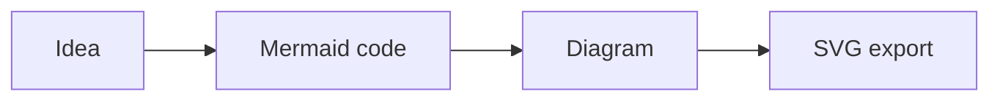
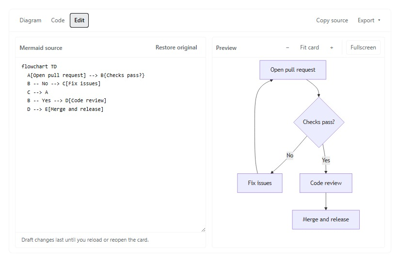
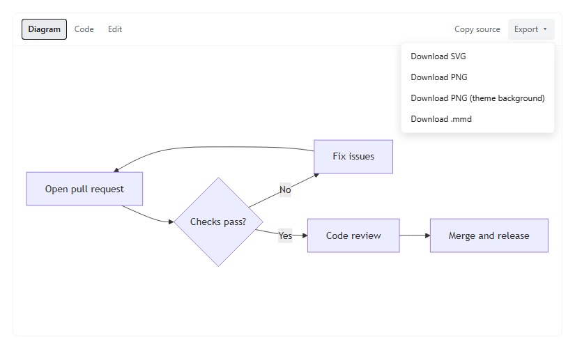
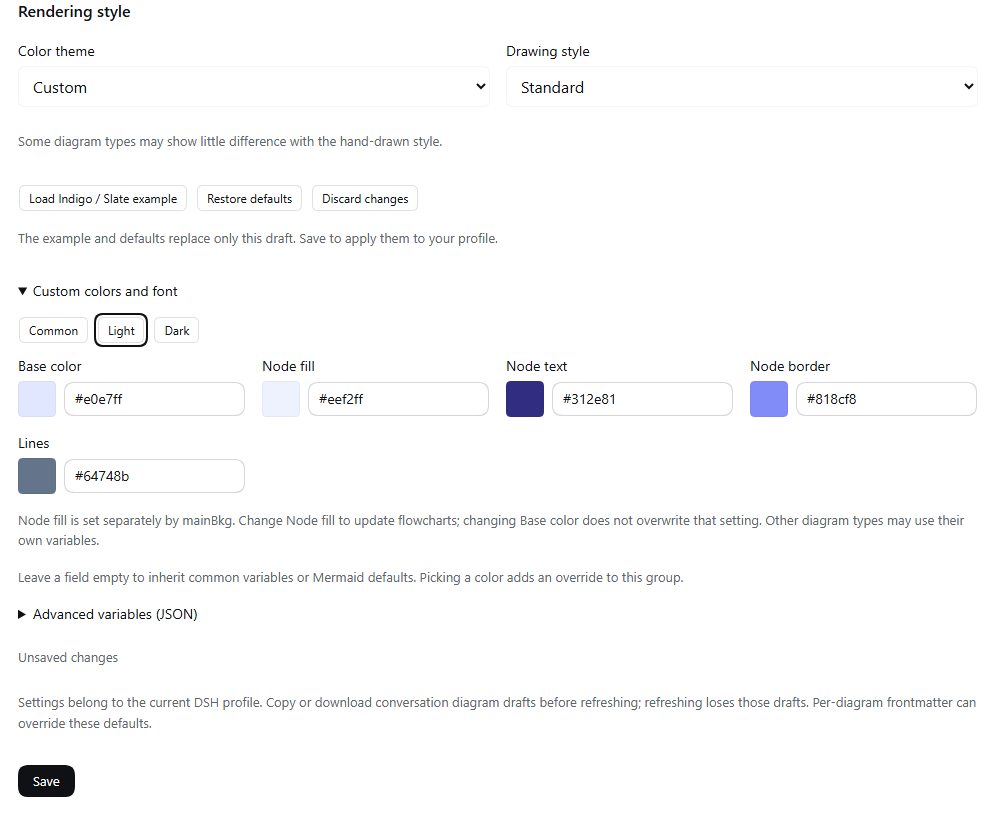

# dsh-mermaid

[简体中文](README.zh-CN.md) | English

Render Mermaid code blocks as interactive SVG diagrams in **DeepSeek Harness Web and Desktop**. Switch between source, diagram, and an inline editor, explore large diagrams in fullscreen, and export SVG, PNG, or Mermaid source from the conversation.

[](https://www.npmjs.com/package/dsh-mermaid)


An English pull request workflow rendered in a DSH conversation. [View the Mermaid source](docs/examples/pull-request-workflow.mmd).

## Quick start

Requires DeepSeek Harness (DSH) and **Node.js 22.19 or later**. Commands below use Windows PowerShell; on macOS or Linux, use `npx` and `npm` in place of `npx.cmd` and `npm.cmd`.

### 1. Install

The walkthrough covers `0.5.0`, which adds inline editing, rendering-style settings, streaming previews, and PNG downloads. If you use an earlier version, see the [update instructions](#update-and-uninstall) and the [changelog](CHANGELOG.md).

With a global `dsh` command, install the npm release into your Web profile:

```powershell
dsh plugin --profile web add -w dsh-mermaid
```

If `dsh` is not on your PATH, invoke it through npx:

```powershell
npx.cmd --yes @deepseek-ai/dsh plugin --profile web add -w dsh-mermaid
```

For **DSH Desktop** on Windows, use the CLI bundled with the app to manage its `desktop` profile. Replace `<DSH Desktop installation>` with your installation directory.

```powershell
& '<DSH Desktop installation>\resources\runtime\cli\bin\dsh.cmd' plugin --profile desktop add -w dsh-mermaid
```

DSH installs the package through pnpm and automatically registers its `dsh.bundle` declaration in the selected profile. Restart DSH Web or DSH Desktop after installation; for an already running Web session, refresh the browser page as well.

### 2. Render a diagram

Ask a model to output a Mermaid fenced code block, for example:

````markdown

````

The block opens in **Diagram** view by default. Use **Diagram / Code / Edit** at the left of the card header to switch views. The plugin also recognizes `mermaidjs` and `mmd` fences; inline code is left unchanged.

On hosts with the Markdown fence slot, a valid diagram can appear while the reply streams. The host's source remains visible until the first preview. Subsequent incomplete updates keep the last valid preview in place. Unlabelled fences can still be recognized from their Mermaid source. In **Code** view, source updates are shown immediately and the preview updates when you open **Diagram** or **Edit**.

On older hosts, an incomplete code block can stay in **Diagram** while more source arrives. Open **Edit** to check its syntax immediately. Diagram previews are queued when their cards approach the viewport.

### 3. Edit the source

- **Edit** opens a source panel alongside the diagram preview. On narrow cards the preview moves below the source. Changes re-render after a short debounce, and rendering messages appear in the preview panel.
- Drafts are local to the page. On DSH hosts with conversation and message identifiers, matching drafts survive card rebuilding and conversation navigation. Copy or download a draft before refreshing.
- While a new source is rendering, or when it has a syntax error, the last successful diagram stays visible with a notice. **Copy source** and **.mmd** always use the raw draft, including comments and whitespace. **Restore original** in the source panel restores the message source.
- **Edit** remains available on errors. With a host-confirmed final code block, an initial syntax error opens **Edit** automatically.
- Syntax errors show a line number when Mermaid reports one. Expand **Error details** for the full parser message.



### 4. Explore and export

- Wide diagrams open at a readable scale and can overflow the canvas. Use **− / Fit card / +** above the preview in **Diagram** and **Edit**. Double-click the canvas to zoom in or reset to fit. Zooming keeps the card height steady. Drag an overflowing diagram to pan horizontally or vertically.
- **Fullscreen**, above the preview in **Diagram** and **Edit**, opens a viewer with mouse-wheel zoom, dragging, 100% reset, and fit-to-window controls. Press `Esc` to close it.
- Pinch to zoom and double-tap to toggle zoom on touchscreens, in the card and fullscreen.
- Open **Export** in the card header to download the entire diagram as SVG or PNG, or the current source as `.mmd`. The preview, fullscreen view, SVG and background PNG use the diagram palette's white or black background. Transparent PNG is also available. PNG uses up to 3× the SVG dimensions, subject to an 8,192-pixel edge and 16-megapixel area limit. File names include a short suffix derived from the source.
- Fullscreen can show the last successful preview during generation. SVG and PNG require an up-to-date preview after the response finishes. The `.mmd` download remains available on rendering and source errors.
- For offline images, use resources Mermaid can embed. SVG external references still depend on their original locations. PNG encoding supports self-contained resources and retries a large canvas once at reduced resolution if the browser rejects its capacity.
- **Retry rendering** reruns the operation on the current source and uses a fresh module URL after a loading failure. Removing a stalled card or reaching the asynchronous render deadline releases the queue to a fresh renderer. **Copy diagnostics** includes diagram type, Mermaid version, failure stage, available line number, and retry count. Select **Include source** to attach the current source to that copy.



<details>
<summary>Fullscreen viewer screenshot</summary>


</details>

## Global rendering styles

The defaults remain `auto` color and `classic` look. Colors support `auto` (follow DSH), `default`, `dark`, `neutral`, `forest`, and `base` (custom). Choose `classic` or `handDrawn` independently. Hand-drawn strokes were confirmed for flowcharts and state diagrams; other types may have little visible difference.

### Native settings form

Open **Plugins → Installed plugins → dsh-mermaid** in the sidebar. The **Rendering style** form offers color and drawing-style selections without locating a file or writing YAML.



- **Style preview** renders a sample flowchart with the current draft. With **Follow DSH** or **Custom**, switch between **Light** and **Dark** to compare variants before saving. If the draft is invalid, the last rendered preview stays visible.
- Select **Custom** to edit fonts, font size, base color, node fill/text/border and line colors under Common / Light / Dark. Empty fields inherit common variables or Mermaid defaults.
- **Base color** edits `primaryColor`; **Node fill** edits `mainBkg`, used by flowcharts and other types. They are saved independently without overwriting advanced settings, with a hint when a separate fill exists. Other diagram types may use dedicated variables.
- Leaving node text unset lets the plugin choose a readable default for an opaque hex fill. An explicit node text color takes precedence.
- Expand **Advanced variables (JSON)** to paste additional variables, including diagram-specific nested objects and arrays. Basic fields preserve unrelated advanced variables, and switching tabs retains each group's input.
- **Load Indigo / Slate example** provides an editable starting point. **Restore defaults** also changes only the draft until saved.
- **Save** validates all groups, submits one revisioned mutation through the host settings service, and confirms accepted readback. Failed or conflicting writes retain the draft; **Discard changes** loads current host values.
- Invalid saved settings retain their original fields and variable trees, with a read-only copy of the original JSON. Repairing one field does not erase the remaining palette. Unsupported structures block Save until repaired in the profile or explicitly replaced with defaults.
- Returning to saved values or changing only JSON formatting does not report unsaved changes. Invalid JSON drafts remain protected on refresh/close.
- Settings drafts survive navigation between the plugin page and conversations. Unsaved settings trigger a browser prompt before refresh or close. Confirmed saves update diagrams in the current page while keeping their drafts and views. ZenUML follows the palette brightness and uses its own diagram colors.

The editor loads on demand and uses host form controls, buttons and typography. It adds no private write endpoint or second storage layer. Hosts without the native form services can still use the profile-file workflow below.

### Advanced: edit the profile file

1. Open the current profile's user layer: `%USERPROFILE%\.dsh\profiles\web\cordis.patch.yml`. If `DSH_HOME` is set, use that root instead. Other systems use `~/.dsh/profiles/web/cordis.patch.yml`. For Desktop, replace `web` with `desktop`.
2. Edit `config` on the existing `id: ui-mermaid` override. If the user layer has no such row, add the following **id-targeted override** for the already-installed plugin. Preserve other rows. Do not insert a second plugin or edit files under `node_modules`.

```yaml
- id: ui-mermaid
  config:
    theme: auto
    look: classic
```

3. Save as **UTF-8 without BOM**. The tested host watches and reloads the profile patch; restart DSH on other versions. Open pages retain their configuration snapshot, with no automatic refresh or cross-window synchronization.
4. **Copy or download any card drafts first**, then refresh the page. Refreshing loses drafts. The user layer survives host restarts and bundle replacement; home-level `cordis.patch.yml` and command-line `--patch` overlays take precedence.

Custom variables apply to `theme: base`, grouped under `themeVariables.common / light / dark`. Use the [complete Indigo / Slate example](docs/examples/render-style-indigo.patch.yml) as a starting point. The active branch overrides common values recursively, and arrays replace inherited arrays. With a custom node fill or base color, Base infers `darkMode` from DSH. Typography-only changes keep the stock light node palette. An explicit `darkMode` takes precedence. Card and fullscreen backgrounds follow the diagram's effective palette.

Only `theme`, `look`, and `themeVariables` are accepted. Variables allow nested plain objects, arrays, strings, booleans and finite numbers; null, unsafe prototype keys and non-JSON values are rejected. Limits: 64 KiB UTF-8 JSON, 8 levels counting each group object as level 1, 2,048 aggregate properties/elements across groups, and 8,192 characters per string. Mermaid may ignore unknown variables; structural validation does not guarantee styling or layout.

Invalid structure falls back to the complete `auto + classic` default and leaves a separate visible configuration warning with bounded field paths. Read failures, the 3-second deadline and responses exceeding 128 KiB also use defaults. Valid variable combinations that fail to render keep the last preview stale and disable SVG export. Stored configuration is never rewritten.

For per-diagram exceptions, use native Mermaid frontmatter in **Edit**, as in the [single-diagram example](docs/examples/single-diagram-style.mmd). Legacy `%%{init: ...}%%` remains supported. Prefer one declaration mechanism; Mermaid 11.17.0 decides precedence if both appear. Per-diagram `themeVariables` use native Mermaid variables directly, without the plugin's common/light/dark groups. Copy and .mmd preserve the original source without inherited global values; Reset restores only the message source.

Diagrams read their snapshot from the same-origin read-only `/dsh-mermaid/config.json` endpoint. The tested host serves this static route with anonymous HTTP 200 and no CORS headers; do not store secrets in style variables. The native form saves through the host's existing authenticated settings service.

See [Compatibility](#compatibility) for tested hosts and platform limitations.

## Features

- **Diagram types.** Use Mermaid's built-in types and `zenuml` sequence diagrams. DSH serves Mermaid `11.17.0` and its diagram modules from the same origin, with ZenUML loaded on demand.
- **Flowchart label recovery.** The renderer can recover some unquoted parentheses and embedded quotes in labels. Code view and `.mmd` downloads preserve the original source.
- **Render limits.** Diagrams use Mermaid's `strict` mode. The queue prioritizes cards near the viewport and rejects sources over 50,000 characters or 2,000 lines before rendering.
- **Language and accessibility.** Controls use English or Simplified Chinese according to DSH and browser language. Cards provide keyboard focus handling, render announcements, and accessible SVG names.

## Update and uninstall

Run the command for your installed profile; replace `web` with `desktop` for DSH Desktop.

```powershell
# Update the npm release
dsh plugin --profile web update -w dsh-mermaid

# Uninstall
dsh plugin --profile web remove -w dsh-mermaid
```

For Web, you can replace the leading `dsh` with `npx.cmd --yes @deepseek-ai/dsh`. Desktop uses its bundled CLI. Exit Windows Desktop from the system tray before updating and reopen it afterward. For Web, restart the host and refresh open pages. Saved profile settings survive plugin updates. Copy or download diagram drafts before refreshing. See the [changelog](CHANGELOG.md) for release details.

## Troubleshooting

| Symptom | What to check |
| --- | --- |
| No Diagram, Code, or Edit controls | Check the active profile, restart DSH, and try an explicit `mermaid` fenced block. Edit requires version `0.5.0` or later. |
| Source appears with an error | Check the Mermaid syntax and the displayed error. Split diagrams that exceed 50,000 characters or 2,000 lines. The **Edit** view remains available for repairs. |
| Preview says it was not updated | The draft is invalid or still rendering. The previous diagram stays available. Fix the source, wait for the preview to update, or use **Restore original**. |
| Fullscreen or image export is unavailable | Wait for the reply to finish and the preview to update. The card can still export the current source as `.mmd`. |
| The renderer or a diagram module failed to load | Choose **Retry rendering**. If it repeats, attach the output of **Copy diagnostics** to your issue. |
| GitHub installation reports a blocked build script | Follow the build-script guidance under **Install from GitHub** below. |

## Compatibility

The repository build was checked on **2026-11-20** with DSH **`0.2.2-rc.5`** on Windows.

| Environment | Verified behavior |
| --- | --- |
| DSH Web from the Desktop bundle, Windows Chromium | Native code blocks, streaming and history replay, theme settings, and the screenshot workflows above. An isolated upgrade from `0.4.5` to `0.5.0` preserved profile settings and other plugin dependencies. |
| Windows Chromium regression suite | Inline editing, touch emulation, SVG and PNG exports, ZenUML, and module-load recovery. |
| DSH Desktop, native Windows window | In-place plugin update with saved profile settings preserved. The application reopened with the Mermaid card controls available. |

The earlier Linux smoke test used a Debian Web host with Windows Chromium. See [screenshot provenance](docs/images/README.md) for the current capture environment and sample source.

DSH is a developer preview; newer versions may change its plugin loader or Markdown DOM. When [reporting an issue](https://github.com/MrmoLabs/dsh-mermaid/issues), include your DSH, plugin, and Node.js versions, Web/Desktop profile, and a minimal Mermaid example. Remove private conversation content before sharing.

## Advanced usage

<details>
<summary>Install from GitHub</summary>

For normal use, prefer the npm release. To install the latest repository source, ensure a global `dsh` command is on your PATH, then run:

```powershell
npx.cmd -y github:MrmoLabs/dsh-mermaid install
```

For DSH Desktop on Windows, use its bundled CLI and replace the example installation directory.

```powershell
& '<DSH Desktop installation>\resources\runtime\cli\bin\dsh.cmd' plugin --profile desktop add -w --save-exact github:MrmoLabs/dsh-mermaid
```

The repository installer asks DSH to install the GitHub source into the selected profile and builds the package during installation. If pnpm blocks a build script, add the exact package key shown by pnpm to `allowBuilds` in that profile's `pnpm-workspace.yaml`, then run the command again. Restart the corresponding DSH application afterward.

The installer supports English and Simplified Chinese. It checks `DSH_MERMAID_LANG`, `DSH_LANG`, `LC_ALL`, `LC_MESSAGES`, `LANG`, and `LANGUAGE` in that order, then uses the system language; neutral `C`/`POSIX` values are skipped. Set `DSH_MERMAID_LANG=en` or `DSH_MERMAID_LANG=zh-CN` to override the choice. This affects the installer’s own messages, independently of the browser interface, DSH, and pnpm.

</details>

<details>
<summary>Runtime and integration boundary</summary>

The Mermaid runtime runs in the DSH Web browser or Desktop renderer, where `window` and `document` are available. The Node.js host serves the bundled file over HTTP. The Node.js version requirement covers installation, builds, and the plugin host; this package does not currently provide a supported Node.js validation API.

The plugin serves the renderer and its diagram modules from the same origin. It loads diagram modules on demand, including the ZenUML extension. `lib/mermaid-runtime.js` and `lib/mermaid-chunks/` are internal assets and may change between builds.

Integrators experimenting with server-side parsing must account for these requirements:

- Some diagram parsers sanitize labels through DOMPurify during `parse()`. Without a DOM, valid labeled flowcharts and state diagrams can throw `addHook is not a function` or `sanitize is not a function`. Successful parsing of one sequence diagram does not establish compatibility for other inputs.
- Provide a compatible DOM **before the first runtime import**, preferably in a dedicated worker or process. DOMPurify captures its environment during initialization; adding a DOM after import does not repair the cached module. Temporarily assigning globals around an asynchronous import can also expose them to other host code. Follow [DOMPurify's server-side guidance](https://github.com/cure53/DOMPurify#running-dompurify-on-the-server) when choosing a DOM implementation.
- On Windows, convert an absolute filesystem path with `pathToFileURL(runtimePath).href` before passing it to dynamic `import()`.
- Distinguish invalid input from unavailable dependencies, environment failures, and timeouts. Mermaid's `.hash` error field is not a universal classifier: invalid pie syntax and unknown diagram types can also fail without it. An incomplete validation must not be reported as successful.
- Use the same Mermaid version and relevant configuration as the renderer. A successful `parse()` checks syntax; it does not guarantee successful layout or SVG rendering. Keep the renderer's error handling and source fallback.

</details>

## Development

From a local checkout, with Node.js 22.19 or later:

```powershell
npm.cmd install
npm.cmd run check
npm.cmd run build
dsh plugin --profile web add -w .
```

Build output is written to `lib/`. The lightweight `client.js` bootstrap is registered with the DSH client module loader as `dsh-mermaid`; the bundled Mermaid runtime is served through the plugin's same-origin host route and loaded on demand. DSH resolves the relative installation path against the current plugin checkout.

`npm.cmd run check` runs syntax and client tests, builds the runtime, and tests its real parser in separate processes with and without a DOM. The DOM-backed parser tests use happy-dom as a test fixture; they do not verify browser layout or SVG rendering, or recommend a production server-side DOM implementation.

To run the same Chromium layout checks as CI, install Playwright's headless Chromium once, then run the smoke checks after building:

```powershell
node node_modules/playwright-core/cli.js install chromium --only-shell
npm.cmd run check:browser -- --smoke
```

Run `npm.cmd run check:browser` for the full Chromium suite.

<details>
<summary>Manual installation for local development</summary>

The built package can also be copied to:

```text
C:\Users\<username>\.dsh\profiles\web\node_modules\dsh-mermaid
```

Never commit the complete `.dsh` directory; it may contain conversations and credentials.

</details>

### Release checks

```powershell
npm.cmd run check
npm.cmd run build
npm.cmd pack --dry-run
git status --short
git diff --cached
```

## License

[MIT](LICENSE)
