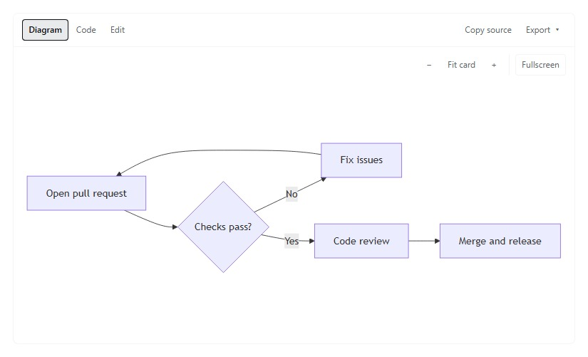
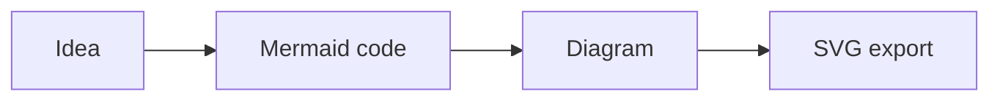
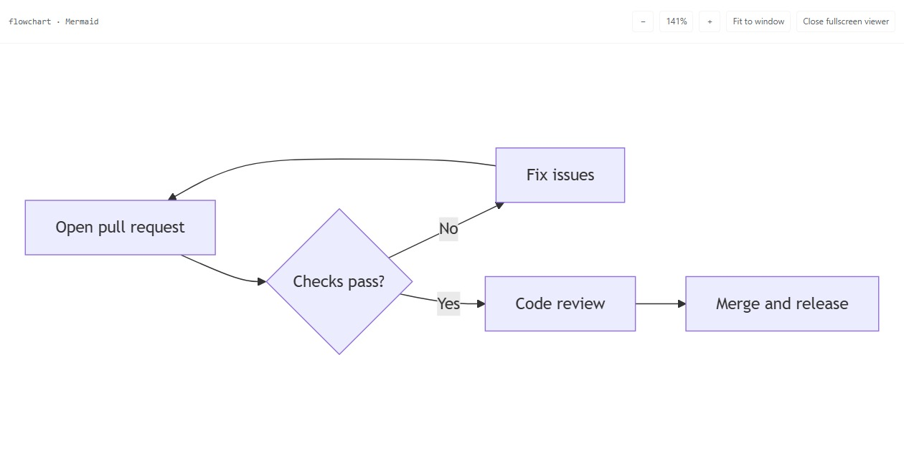

# dsh-mermaid

[简体中文](README.zh-CN.md) | English

Render Mermaid code blocks as interactive SVG diagrams in **DeepSeek Harness Web and Desktop**. Switch between source, diagram, and an inline editor, explore large diagrams in fullscreen, and export SVG, PNG, or Mermaid source from the conversation.

[](https://www.npmjs.com/package/dsh-mermaid)



An English pull request workflow rendered in a DSH conversation. [View the Mermaid source](docs/examples/pull-request-workflow.mmd).

## Quick start

Requires DeepSeek Harness (DSH) and **Node.js 22.19 or later**. Commands below use Windows PowerShell; on macOS or Linux, use `npx` and `npm` in place of `npx.cmd` and `npm.cmd`.

### 1. Install

With a global `dsh` command, install the npm release into your Web profile:

```powershell
dsh plugin --profile web add -w dsh-mermaid
```

If `dsh` is not on your PATH, invoke it through npx:

```powershell
npx.cmd --yes @deepseek-ai/dsh plugin --profile web add -w dsh-mermaid
```

For **DSH Desktop**, use the `dsh` command supplied by the Desktop installation and replace `--profile web` with `--profile desktop`. The npm/npx DSH CLI cannot manage the reserved `desktop` profile on current Desktop versions. If the bundled command is not on your PATH, invoke `<DSH Desktop installation>\resources\runtime\cli\bin\dsh.cmd` on Windows.

DSH installs the package through pnpm and automatically registers its `dsh.bundle` declaration in the selected profile. Restart DSH Web or DSH Desktop after installation; for an already running Web session, refresh the browser page as well.

### 2. Render a diagram

Ask a model to output a Mermaid fenced code block, for example:

````markdown

````

The block opens in **Diagram** view by default. Use **Diagram / Code / Edit** at the left of the card header to switch views. The plugin also recognizes `mermaidjs` and `mmd` fences; inline code is left unchanged.

On hosts with the Markdown fence slot, an active reply shows the host's source block until generation finishes. In **Code** view, source updates are shown immediately and the preview updates when you open **Diagram** or **Edit**.

### 3. Edit the source

- **Edit** opens a source panel alongside the diagram preview. On narrow cards the preview moves below the source. Changes re-render after a short debounce, and rendering messages appear in the preview panel.
- The draft is local to this page and is never written back to the sent message. Refreshing the page or rebuilding the card discards it.
- While a new source is rendering, or when it has a syntax error, the last successful diagram stays visible with a notice. **Copy source** and **.mmd** always use the raw draft, including comments and whitespace. **Restore original** in the source panel restores the message source.
- The initial parse error case still opens in **Edit**, so a block that failed to render can be repaired in place.

### 4. Explore and export

- Use **− / Fit card / +** above the preview in **Diagram** and **Edit**. Zooming keeps the card height steady. When the diagram extends beyond the canvas, drag it to pan horizontally or vertically.
- **Fullscreen**, above the preview in **Diagram** and **Edit**, opens a viewer with mouse-wheel zoom, dragging, 100% reset, and fit-to-window controls. Press `Esc` to close it.
- Open **Export** in the card header to download the entire diagram as SVG or PNG, or the current source as `.mmd`. PNG preserves transparency and uses up to 2× the SVG dimensions, subject to an 8,192-pixel edge and 16-megapixel area limit.
- Fullscreen, SVG, and PNG require an up-to-date preview. The `.mmd` download remains available while the draft is rendering or contains an error.
- **Retry rendering** reruns a failed renderer operation on the current source. **Copy diagnostics** copies the diagram type, Mermaid version, stage, and retry count.



## Global rendering styles (source version, unreleased)

The defaults remain `auto` color and `classic` look. Colors support `auto` (follow DSH), `default`, `dark`, `neutral`, `forest`, and `base` (custom). Choose `classic` or `handDrawn` independently. Hand-drawn strokes were confirmed for flowcharts and state diagrams; other types may have little visible difference.

The following workflow was verified with **DSH 0.2.2-rc.3 on Windows Web and Desktop**:

### Recommended: native settings form

Open **Plugins → Installed plugins → dsh-mermaid** in the sidebar. The **Rendering style** form offers color and drawing-style selections without locating a file or writing YAML.

- Select **Custom** to edit fonts, font size, base color, node fill/text/border and line colors under Common / Light / Dark. Empty fields inherit common variables or Mermaid defaults.
- **Base color** edits `primaryColor`; **Node fill** edits `mainBkg`, used by flowcharts and other types. They are saved independently without overwriting advanced settings, with a hint when a separate fill exists. Other diagram types may use dedicated variables.
- Expand **Advanced variables (JSON)** to paste additional variables, including diagram-specific nested objects and arrays. Basic fields preserve unrelated advanced variables, and switching tabs retains each group's input.
- **Load Indigo / Slate example** provides an editable starting point. **Restore defaults** also changes only the draft until saved.
- **Save** validates all groups, submits one revisioned mutation through the host settings service, and confirms accepted readback. Failed or conflicting writes retain the draft; **Discard changes** loads current host values.
- Invalid saved settings retain their original fields and variable trees, with a read-only copy of the original JSON. Repairing one field does not erase the remaining palette. Unsupported structures block Save until repaired in the profile or explicitly replaced with defaults.
- Returning to saved values or changing only JSON formatting does not report unsaved changes. Invalid JSON drafts remain protected on refresh/close.
- Settings drafts survive navigation between the plugin page and conversations. Unsaved settings trigger a browser prompt before refresh/close. Saved settings apply to diagrams after a refresh: **copy or download conversation diagram drafts first**.

The editor loads on demand and uses host form controls, buttons and typography. It adds no private write endpoint or second storage layer. Hosts without the native form services can still use the profile-file workflow below.

### Advanced: edit the profile file

1. Open the current profile's user layer: `%USERPROFILE%\.dsh\profiles\web\cordis.patch.yml`. If `DSH_HOME` is set, use that root instead. Other systems use `~/.dsh/profiles/web/cordis.patch.yml`. For Desktop, replace `web` with `desktop`.
2. Edit `config` on the existing `id: ui-mermaid` override. If the user layer has no such row, add the following **id-targeted override** for the already-installed plugin. Preserve other rows. Do not insert a second plugin or edit files under `node_modules`.

```yaml
- id: ui-mermaid
  config:
    theme: auto
    look: classic
```

3. Save as **UTF-8 without BOM**. The tested host watches and reloads the profile patch; restart DSH on other versions. Open pages retain their configuration snapshot, with no automatic refresh or cross-window synchronization.
4. **Copy or download any card drafts first**, then refresh the page. Refreshing loses drafts. The user layer survives host restarts and bundle replacement; home-level `cordis.patch.yml` and command-line `--patch` overlays take precedence.

Custom variables apply only to `theme: base`, grouped under `themeVariables.common / light / dark`. Merge the [complete indigo/slate example](docs/examples/render-style-indigo.patch.yml) into your existing patch. The active branch recursively overrides common values; arrays replace rather than concatenate. Missing branches use common and Mermaid-derived values. Unspecified `darkMode` follows DSH. Other color themes retain your stored variables but do not pass them to Mermaid. Card and fullscreen backgrounds follow DSH; check contrast when using fixed themes or custom colors.

Only `theme`, `look`, and `themeVariables` are accepted. Variables allow nested plain objects, arrays, strings, booleans and finite numbers; null, unsafe prototype keys and non-JSON values are rejected. Limits: 64 KiB UTF-8 JSON, 8 levels counting each group object as level 1, 2,048 aggregate properties/elements across groups, and 8,192 characters per string. Mermaid may ignore unknown variables; structural validation does not guarantee styling or layout.

Invalid structure falls back to the complete `auto + classic` default and leaves a separate visible configuration warning with bounded field paths. Read failures, the 3-second deadline and responses exceeding 128 KiB also use defaults. Valid variable combinations that fail to render keep the last preview stale and disable SVG export. Stored configuration is never rewritten.

For per-diagram exceptions, use native Mermaid frontmatter in **Edit**, as in the [single-diagram example](docs/examples/single-diagram-style.mmd). Legacy `%%{init: ...}%%` remains supported. Prefer one declaration mechanism; Mermaid 11.17.0 decides precedence if both appear. Per-diagram `themeVariables` use native Mermaid variables directly, without the plugin's common/light/dark groups. Copy and .mmd preserve the original source without inherited global values; Reset restores only the message source.

Diagrams read their snapshot from the same-origin read-only `/dsh-mermaid/config.json` endpoint. The tested host serves this static route with anonymous HTTP 200 and no CORS headers; do not store secrets in style variables. The native form saves through the host's existing authenticated settings service.

See [Compatibility](#compatibility) for tested hosts and platform limitations.

## Features

- **Inline editing** — edit the Mermaid source in place with a debounced live preview, keeping the last good diagram while the draft is invalid or rendering.
- **Streaming support** — discovers new blocks as responses arrive and prevents older renders from replacing newer content.
- **Theme and language** — follows DSH's light/dark theme and uses English or Simplified Chinese based on the page and browser language.
- **Large-diagram viewing** — fullscreen zoom and pan, with a stable toolbar position when switching views.
- **Accessible controls** — keyboard focus management, render/download announcements, and accessible SVG names.
- **Bundled runtime** — pins Mermaid `11.17.0`, loads it on demand from DSH's own origin, and requires no runtime CDN. Multiple diagrams render through a serial queue.
- **Source fallback** — uses Mermaid's `securityLevel: strict`; on a render error the last successful diagram remains and the editor stays available. Diagrams exceeding 50,000 characters or 2,000 lines are rejected before rendering.

## Update and uninstall

Run the command for your installed profile; replace `web` with `desktop` for DSH Desktop.

```powershell
# Update the npm release
dsh plugin --profile web update -w dsh-mermaid

# Uninstall
dsh plugin --profile web remove -w dsh-mermaid
```

For Web, you can replace the leading `dsh` with `npx.cmd --yes @deepseek-ai/dsh`. Desktop requires its bundled `dsh` command. Restart the corresponding DSH application afterward and refresh any open Web page. Saved profile settings are retained when the plugin is replaced; copy or download any diagram drafts before refreshing. See the [changelog](CHANGELOG.md) for release details.

## Troubleshooting

| Symptom | What to check |
| --- | --- |
| No Code / Diagram / Edit controls | Confirm that the plugin is installed in the profile you are using, restart DSH, and refresh the page. Use an explicit `mermaid` fenced block. |
| Source appears with an error | Check the Mermaid syntax and the displayed error. Split diagrams that exceed 50,000 characters or 2,000 lines. The **Edit** view remains available for repairs. |
| Preview says it was not updated | The draft is invalid or still rendering. The previous diagram stays available. Fix the source, wait for the preview to update, or use **Restore original**. |
| Fullscreen or download is unavailable | These actions require a successfully rendered SVG. Resolve any rendering error first. |
| GitHub installation reports a blocked build script | Follow the build-script guidance under **Install from GitHub** below. |

## Compatibility

The current **unreleased source** was checked on **2026-11-17**:

| Environment | DSH version | Verified behavior |
| --- | --- | --- |
| Windows Web / Chrome | `0.2.1-rc.2`, Desktop-bundled `0.2.2-rc.3` | Eight diagram types, settings save/reload, fullscreen, SVG export and package upgrades. |
| Windows Desktop native window | `0.2.2-rc.3` | Flowchart rendering/editing, settings save, fullscreen, native SVG saving and package upgrades. |
| Linux x64 Web host / Windows Chrome | `0.2.1-rc.2` | Eight diagram types, settings save/reload, fullscreen, SVG export and package upgrades. |

Upgrading from npm `0.4.5` to the current build retained saved rendering settings and other profile overrides. The Linux host ran on Node.js 24.22.3 in a Debian container; a Linux-native browser and macOS were not tested.

Fixed themes on opposite host backgrounds and incomplete `base` palettes can make text hard to read. Prefer `auto` for host-theme switching, or check both light and dark custom variable branches. The earlier screenshots above remain from the 2026-10-28 Web check. These results apply to the source version and do not imply a new npm release.

DSH is a developer preview; newer versions may change its plugin loader or Markdown DOM. When [reporting an issue](https://github.com/MrmoLabs/dsh-mermaid/issues), include your DSH, plugin, and Node.js versions, Web/Desktop profile, and a minimal Mermaid example. Remove private conversation content before sharing.

## Advanced usage

<details>
<summary>Install from GitHub</summary>

For normal use, prefer the npm release. To install the latest repository source, ensure a global `dsh` command is on your PATH, then run:

```powershell
npx.cmd -y github:MrmoLabs/dsh-mermaid install
```

For DSH Desktop:

```powershell
npx.cmd -y github:MrmoLabs/dsh-mermaid install --profile desktop
```

The repository installer asks DSH to install the GitHub source into the selected profile and builds the package during installation. If pnpm blocks a build script, add the exact package key shown by pnpm to `allowBuilds` in that profile's `pnpm-workspace.yaml`, then run the command again. Restart the corresponding DSH application afterward.

The installer supports English and Simplified Chinese. It checks `DSH_MERMAID_LANG`, `DSH_LANG`, `LC_ALL`, `LC_MESSAGES`, `LANG`, and `LANGUAGE` in that order, then uses the system language; neutral `C`/`POSIX` values are skipped. Set `DSH_MERMAID_LANG=en` or `DSH_MERMAID_LANG=zh-CN` to override the choice. This affects the installer’s own messages, independently of the browser interface, DSH, and pnpm.

</details>

<details>
<summary>Runtime and integration boundary</summary>

The Mermaid runtime runs in the DSH Web browser or Desktop renderer, where `window` and `document` are available. The Node.js host serves the bundled file over HTTP. The Node.js version requirement covers installation, builds, and the plugin host; this package does not currently provide a supported Node.js validation API.

`lib/mermaid-runtime.js` is an internal browser bundle. It is shipped for the plugin's same-origin runtime route and is not a public package export. Resolving `dsh-mermaid/package.json` and constructing a path to this file depends on internal packaging details that may change.

Integrators experimenting with server-side parsing must account for these requirements:

- Some diagram parsers sanitize labels through DOMPurify during `parse()`. Without a DOM, valid labeled flowcharts and state diagrams can throw `addHook is not a function` or `sanitize is not a function`. Successful parsing of one sequence diagram does not establish compatibility for other inputs.
- Provide a compatible DOM **before the first runtime import**, preferably in a dedicated worker or process. DOMPurify captures its environment during initialization; adding a DOM after import does not repair the cached module. Temporarily assigning globals around an asynchronous import can also expose them to other host code. Follow [DOMPurify's server-side guidance](https://github.com/cure53/DOMPurify#running-dompurify-on-the-server) when choosing a DOM implementation.
- On Windows, convert an absolute filesystem path with `pathToFileURL(runtimePath).href` before passing it to dynamic `import()`.
- Distinguish invalid input from unavailable dependencies, environment failures, and timeouts. Mermaid's `.hash` error field is not a universal classifier: invalid pie syntax and unknown diagram types can also fail without it. An incomplete validation must not be reported as successful.
- Use the same Mermaid version and relevant configuration as the renderer. A successful `parse()` checks syntax; it does not guarantee successful layout or SVG rendering. Keep the renderer's error handling and source fallback.

</details>

## Development

From a local checkout, with Node.js 22.19 or later:

```powershell
npm.cmd install
npm.cmd run check
npm.cmd run build
dsh plugin --profile web add -w .
```

Build output is written to `lib/`. The lightweight `client.js` bootstrap is registered with the DSH client module loader as `dsh-mermaid`; the bundled Mermaid runtime is served through the plugin's same-origin host route and loaded on demand. DSH resolves the relative installation path against the current plugin checkout.

`npm.cmd run check` runs syntax and client tests, builds the runtime, and tests its real parser in separate processes with and without a DOM. The DOM-backed parser tests use happy-dom as a test fixture; they do not verify browser layout or SVG rendering, or recommend a production server-side DOM implementation.

<details>
<summary>Manual installation for local development</summary>

The built package can also be copied to:

```text
C:\Users\<username>\.dsh\profiles\web\node_modules\dsh-mermaid
```

Never commit the complete `.dsh` directory; it may contain conversations and credentials.

</details>

### Release checks

```powershell
npm.cmd run check
npm.cmd run build
npm.cmd pack --dry-run
git status --short
git diff --cached
```

## License

[MIT](LICENSE)
