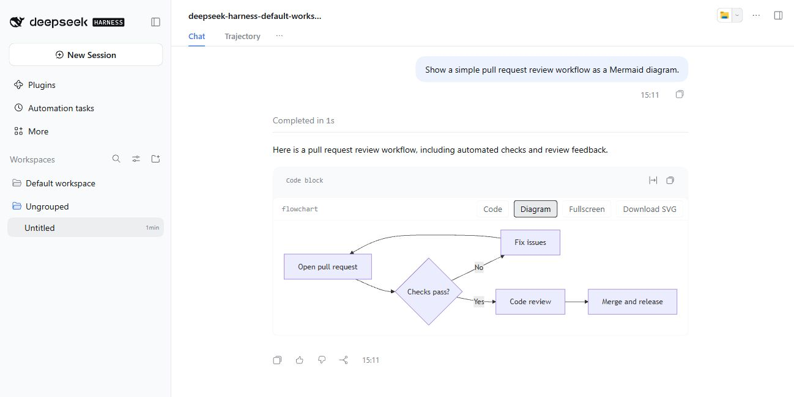
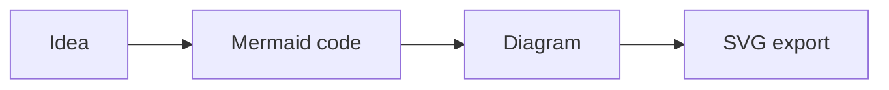
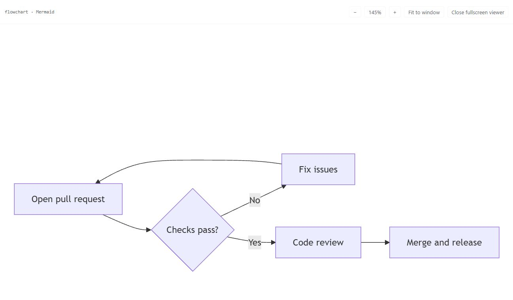

# dsh-mermaid

[简体中文](README.zh-CN.md) | English

Render Mermaid code blocks as interactive SVG diagrams in **DeepSeek Harness Web and Desktop**. Switch between source and diagram, explore large diagrams in fullscreen, and export SVG files without leaving the conversation.

[](https://www.npmjs.com/package/dsh-mermaid)



An English pull request workflow rendered in a DSH conversation. [View the Mermaid source](docs/examples/pull-request-workflow.mmd).

## Quick start

Requires DeepSeek Harness (DSH) and **Node.js 22.19 or later**. Commands below use Windows PowerShell; on macOS or Linux, use `npx` and `npm` in place of `npx.cmd` and `npm.cmd`.

### 1. Install

With a global `dsh` command, install the npm release into your Web profile:

```powershell
dsh plugin --profile web add -w dsh-mermaid
```

If `dsh` is not on your PATH, invoke it through npx:

```powershell
npx.cmd --yes @deepseek-ai/dsh plugin --profile web add -w dsh-mermaid
```

For **DSH Desktop**, replace `--profile web` with `--profile desktop`. DSH installs the package through pnpm and automatically registers its `dsh.bundle` declaration in the selected profile. Restart DSH Web or DSH Desktop after installation; for an already running Web session, refresh the browser page as well.

### 2. Render a diagram

Ask a model to output a Mermaid fenced code block, for example:

````markdown

````

The block opens in **Diagram** view by default. Use **Code / Diagram** to switch views. The plugin also recognizes `mermaidjs` and `mmd` fences; inline code is left unchanged.

### 3. Explore and export

- **Fullscreen** opens a viewer with mouse-wheel zoom, dragging, 100% reset, and fit-to-window controls. Press `Esc` to close it.
- **Download SVG** saves the rendered diagram as a standalone file.
- Both actions remain available in Code view once a diagram has rendered successfully.



## Features

- **Streaming support** — discovers new blocks as responses arrive and prevents older renders from replacing newer content.
- **Theme and language** — follows DSH's light/dark theme and uses English or Simplified Chinese based on the page and browser language.
- **Large-diagram viewing** — fullscreen zoom and pan, with a stable toolbar position when switching views.
- **Accessible controls** — keyboard focus management, render/download announcements, and accessible SVG names.
- **Bundled runtime** — pins Mermaid `11.17.0`, loads it on demand from DSH's own origin, and requires no runtime CDN. Multiple diagrams render through a serial queue.
- **Source fallback** — uses Mermaid's `securityLevel: strict` and returns to source on rendering errors. Diagrams exceeding 50,000 characters or 2,000 lines are rejected before rendering.

## Update and uninstall

Run the command for your installed profile; replace `web` with `desktop` for DSH Desktop.

```powershell
# Update the npm release
dsh plugin --profile web update -w dsh-mermaid

# Uninstall
dsh plugin --profile web remove -w dsh-mermaid
```

If needed, replace the leading `dsh` with `npx.cmd --yes @deepseek-ai/dsh`. Restart the corresponding DSH application afterward and refresh any open Web page. See the [changelog](CHANGELOG.md) for release details.

## Troubleshooting

| Symptom | What to check |
| --- | --- |
| No Code / Diagram controls | Confirm that the plugin is installed in the profile you are using, restart DSH, and refresh the page. Use an explicit `mermaid` fenced block. |
| Source appears with an error | Check the Mermaid syntax and the displayed error. Split diagrams that exceed 50,000 characters or 2,000 lines. |
| Fullscreen or download is unavailable | These actions require a successfully rendered SVG. Resolve any rendering error first. |
| GitHub installation reports a blocked build script | Follow the build-script guidance under **Install from GitHub** below. |

## Compatibility

The most recent UI check was on **2026-10-28**, using Windows / Chrome, `@deepseek-ai/dsh 0.2.1-rc.3` (Web profile), and `dsh-mermaid 0.4.4`. The DSH host ran on Node.js 24.21.0 bundled with DSH Desktop.

An isolated environment with a local example conversation confirmed English flowchart rendering, toolbar display, opening and closing fullscreen, and fullscreen panning. The screenshots above come from that environment. This was a UI smoke check; it did not cover a full feature regression or the native Desktop window.

DSH is a developer preview; newer versions may change its plugin loader or Markdown DOM. When [reporting an issue](https://github.com/MrmoLabs/dsh-mermaid/issues), include your DSH, plugin, and Node.js versions, Web/Desktop profile, and a minimal Mermaid example. Remove private conversation content before sharing.

## Advanced usage

<details>
<summary>Install from GitHub</summary>

For normal use, prefer the npm release. To install the latest repository source, ensure a global `dsh` command is on your PATH, then run:

```powershell
npx.cmd -y github:MrmoLabs/dsh-mermaid install
```

For DSH Desktop:

```powershell
npx.cmd -y github:MrmoLabs/dsh-mermaid install --profile desktop
```

The repository installer asks DSH to install the GitHub source into the selected profile and builds the package during installation. If pnpm blocks a build script, add the exact package key shown by pnpm to `allowBuilds` in that profile's `pnpm-workspace.yaml`, then run the command again. Restart the corresponding DSH application afterward.

The installer supports English and Simplified Chinese. It checks `DSH_MERMAID_LANG`, `DSH_LANG`, `LC_ALL`, `LC_MESSAGES`, `LANG`, and `LANGUAGE` in that order, then uses the system language; neutral `C`/`POSIX` values are skipped. Set `DSH_MERMAID_LANG=en` or `DSH_MERMAID_LANG=zh-CN` to override the choice. This affects the installer’s own messages, independently of the browser interface, DSH, and pnpm.

</details>

<details>
<summary>Runtime and integration boundary</summary>

The Mermaid runtime runs in the DSH Web browser or Desktop renderer, where `window` and `document` are available. The Node.js host serves the bundled file over HTTP. The Node.js version requirement covers installation, builds, and the plugin host; this package does not currently provide a supported Node.js validation API.

`lib/mermaid-runtime.js` is an internal browser bundle. It is shipped for the plugin's same-origin runtime route and is not a public package export. Resolving `dsh-mermaid/package.json` and constructing a path to this file depends on internal packaging details that may change.

Integrators experimenting with server-side parsing must account for these requirements:

- Some diagram parsers sanitize labels through DOMPurify during `parse()`. Without a DOM, valid labeled flowcharts and state diagrams can throw `addHook is not a function` or `sanitize is not a function`. Successful parsing of one sequence diagram does not establish compatibility for other inputs.
- Provide a compatible DOM **before the first runtime import**, preferably in a dedicated worker or process. DOMPurify captures its environment during initialization; adding a DOM after import does not repair the cached module. Temporarily assigning globals around an asynchronous import can also expose them to other host code. Follow [DOMPurify's server-side guidance](https://github.com/cure53/DOMPurify#running-dompurify-on-the-server) when choosing a DOM implementation.
- On Windows, convert an absolute filesystem path with `pathToFileURL(runtimePath).href` before passing it to dynamic `import()`.
- Distinguish invalid input from unavailable dependencies, environment failures, and timeouts. Mermaid's `.hash` error field is not a universal classifier: invalid pie syntax and unknown diagram types can also fail without it. An incomplete validation must not be reported as successful.
- Use the same Mermaid version and relevant configuration as the renderer. A successful `parse()` checks syntax; it does not guarantee successful layout or SVG rendering. Keep the renderer's error handling and source fallback.

</details>

## Development

From a local checkout, with Node.js 22.19 or later:

```powershell
npm.cmd install
npm.cmd run check
npm.cmd run build
dsh plugin --profile web add -w .
```

Build output is written to `lib/`. The lightweight `client.js` bootstrap is registered with the DSH client module loader as `dsh-mermaid`; the bundled Mermaid runtime is served through the plugin's same-origin host route and loaded on demand. DSH resolves the relative installation path against the current plugin checkout.

`npm.cmd run check` runs syntax and client tests, builds the runtime, and tests its real parser in separate processes with and without a DOM. The DOM-backed parser tests use happy-dom as a test fixture; they do not verify browser layout or SVG rendering, or recommend a production server-side DOM implementation.

<details>
<summary>Manual installation for local development</summary>

The built package can also be copied to:

```text
C:\Users\<username>\.dsh\profiles\web\node_modules\dsh-mermaid
```

Never commit the complete `.dsh` directory; it may contain conversations and credentials.

</details>

### Release checks

```powershell
npm.cmd run check
npm.cmd run build
npm.cmd pack --dry-run
git status --short
git diff --cached
```

## License

[MIT](LICENSE)
