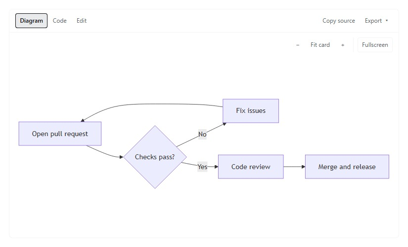
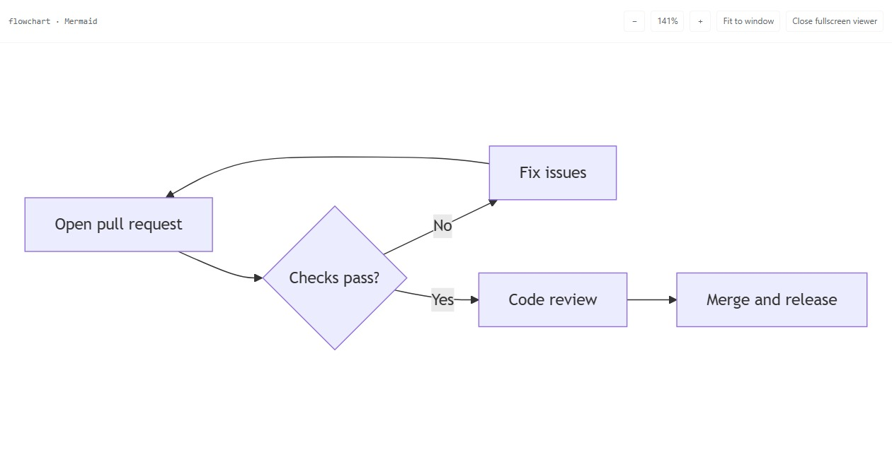
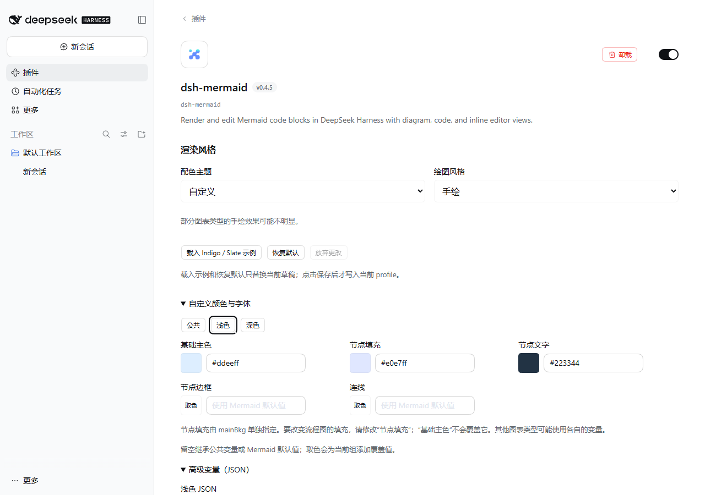

# dsh-mermaid

简体中文 | [English](README.md)

在 **DeepSeek Harness Web 和 Desktop** 会话中，把 Mermaid 代码块渲染为可交互的 SVG 图形。随时切换源码、图形与内联编辑器，全屏查看大型图表，并在会话内导出 SVG、PNG 或 Mermaid 源码。

[](https://www.npmjs.com/package/dsh-mermaid)



英文 Pull Request 工作流在 DSH 会话中的实际效果。[查看 Mermaid 源码](docs/examples/pull-request-workflow.mmd)。

## 快速开始

需要 DeepSeek Harness（DSH）和 **Node.js 22.19 或更高版本**。以下命令使用 Windows PowerShell；macOS / Linux 用户请将 `npx.cmd`、`npm.cmd` 替换为 `npx`、`npm`。

### 1. 安装插件

已全局安装 `dsh` 时，将 npm 发布版安装到 Web profile：

```powershell
dsh plugin --profile web add -w dsh-mermaid
```

如果 PATH 中没有 `dsh` 命令，可通过 npx 调用：

```powershell
npx.cmd --yes @deepseek-ai/dsh plugin --profile web add -w dsh-mermaid
```

使用 **DSH Desktop** 时，请使用 Desktop 安装包随附的 `dsh` 命令，并将 `--profile web` 替换为 `--profile desktop`。当前 Desktop 版本的 `desktop` profile 不能通过 npm/npx 版 DSH CLI 管理。Windows 用户若未配置 PATH，可直接调用 `<DSH Desktop 安装目录>\resources\runtime\cli\bin\dsh.cmd`。

DSH 会通过 pnpm 安装包，并根据包内的 `dsh.bundle` 声明自动注册到所选 profile。安装后重启 DSH Web 或 DSH Desktop；已经打开的 Web 页面也请刷新。

### 2. 生成图表

让模型输出 Mermaid 围栏代码块，例如：

````markdown

````

代码块默认显示为**图形**。用卡片顶部左侧的**图形 / 代码 / 编辑**切换视图。插件也识别 `mermaidjs`、`mmd` 围栏标记，不处理行内代码。

支持 Markdown 围栏插槽的宿主会在生成中显示原始代码块，生成结束后再绘图。无语言标记的围栏仍可按 Mermaid 源码识别。**代码**视图会立即更新原文，切到**图形**或**编辑**时更新预览。

旧宿主遇到可能尚未写完的源码时，会留在**图形**视图等待更新。也可以打开**编辑**立即检查语法。图表卡片接近视口后才进入渲染队列。

### 3. 编辑源码

- **编辑**并排显示源码和图形预览。卡片较窄时，预览移到源码下方。修改后预览会自动更新，渲染提示显示在预览面板内。
- 草稿仅保存在当前页面，不会写回已发送的消息。刷新页面或卡片重建后草稿会丢失。
- 新源码正在渲染或存在语法错误时，上次成功的图会继续显示，并给出提示。**复制源码**与 **.mmd** 始终使用原始草稿，包括注释和空白。源码面板内的**恢复原文**会恢复消息中的源码。
- 出现错误后仍可打开**编辑**原地修复。宿主确认代码块已生成完毕时，首次语法错误会自动打开**编辑**。
- Mermaid 提供行号时，语法提示会标出出错行。展开**错误详情**可以查看解析器输出。

### 4. 查看与导出

- 宽图以便于阅读的比例打开，超出画布的部分可拖动查看。**图形**和**编辑**视图都可用预览上方的 **− / 适应卡片 / +** 缩放。双击画布可放大或恢复适应，卡片高度保持稳定。
- **图形**和**编辑**视图都可从预览上方进入**全屏**，支持鼠标滚轮缩放、拖拽、恢复 100% 和适应窗口。按 `Esc` 关闭。
- 点击卡片顶部的**导出**，可将完整图表保存为 SVG 或 PNG，或将当前源码保存为 `.mmd`。卡片、全屏、SVG 和带背景的 PNG 会按图表配色使用白底或黑底。PNG 也可选透明背景。导出分辨率最高为 SVG 原始尺寸的 2 倍，最长边不超过 8,192 像素，总面积不超过 1,600 万像素。文件名带有根据源码生成的短后缀。
- 全屏、SVG 和 PNG 需要与当前草稿一致的预览。草稿正在渲染或有错误时，仍可下载 `.mmd`。
- **重试渲染**会用当前源码重新运行失败的操作。运行时加载失败后，重试会使用新的模块地址。异步渲染等待超过 15 秒时，下一张排队的图会使用新运行时实例。**复制诊断**合并当前源码和主题下的重复失败，包含图种、Mermaid 版本、失败阶段、可用行号和重试次数。



## 全局渲染风格（源码版，尚未发布）

不配置时保持 `auto` 配色与 `classic` 绘图风格。配色支持 `auto`（跟随 DSH）、`default`、`dark`、`neutral`、`forest`、`base`（自定义）；绘图风格独立支持 `classic` 和 `handDrawn`。手绘在流程图、状态图上已确认有笔触变化，其他类型可能没有明显效果。

以下操作已在 **DSH 0.2.2-rc.3 的 Windows Web 和 Desktop** 中验证：

### 推荐：原生设置表单

打开侧边栏 **插件 → 已安装插件 → dsh-mermaid**，在“渲染风格”中选择配色主题和绘图风格，无需查找或手写 YAML。



- 选择**自定义**后，可在公共／浅色／深色标签页设置字体、字号、基础主色、节点填充、文字、边框和连线颜色。留空继承公共变量或 Mermaid 默认值。
- **基础主色**对应 `primaryColor`，**节点填充**对应流程图等类型使用的 `mainBkg`。两者独立保存，不会擅自覆盖高级设置；存在独立填充时会显示说明。其他图表可能使用专属变量。
- 展开**高级变量（JSON）**可粘贴更多变量，包括图表专属的嵌套对象和数组；修改常用输入框会保留其他高级字段。三个标签页分别保留输入。
- **载入 Indigo / Slate 示例**提供可继续修改的起点；**恢复默认**也只修改草稿，不会立即写入配置。
- 点击**保存**时先校验全部变量，再通过宿主原生设置服务一次写入当前 profile，回读确认后显示成功。错误或配置冲突会保留草稿；**放弃更改**读取当前宿主值。
- 已保存配置有拼写或变量错误时，编辑器保留原有字段与变量，并提供原始 JSON 的只读副本。修正某个字段不会清空其他配色；无法通过常规字段修复的结构会阻止保存，可在 profile 中修复，或明确恢复默认。
- 改回已保存值或只调整 JSON 排版时，不会误报未保存；无效 JSON 草稿仍会受到离页保护。
- 在插件页与会话之间切换会保留设置草稿；刷新或关闭页面前会对未保存的设置给出浏览器提示。保存后仍需刷新页面才能应用到图表：**请先复制或下载需要保留的图表草稿**。

此入口按需加载，使用宿主表单、按钮与字体；没有独立写入端点或第二套存储。缺少原生表单服务的宿主可继续使用下面的 profile 配置方式。

### 进阶：编辑 profile 文件

1. 找到当前 profile 的用户层文件 `%USERPROFILE%\.dsh\profiles\web\cordis.patch.yml`；设置了 `DSH_HOME` 时，根目录改为该变量的值。Desktop 用户将路径中的 `web` 替换为 `desktop`。
2. 在文件中修改现有 `id: ui-mermaid` 覆盖行的 `config`。如果文件尚无该行，添加下面这个 **id 定位的覆盖项**，它修改安装包已注册的插件，不使用 `insert` 再安装一次。保留文件中其他插件和覆盖项；不要修改 `node_modules` 内的配置或 bundle。

```yaml
- id: ui-mermaid
  config:
    theme: auto
    look: classic
```

3. 保存为 **UTF-8 无 BOM**。目标版本会通过 profile 文件监视器重载配置；其他宿主版本请重启对应 DSH 应用。当前页面保持原配置快照，不自动刷新，也不跨窗口同步。
4. **先复制或下载需要保留的卡片草稿**，再刷新页面以应用新快照。刷新会丢失草稿。配置保存在用户层，重启或替换插件 bundle 不会覆盖它；家目录级 `cordis.patch.yml` 和启动时的 `--patch` 覆盖层优先级更高。

自定义仅在 `theme: base` 下生效，使用 `themeVariables.common / light / dark` 三组；[完整 indigo/slate 明暗配置示例](docs/examples/render-style-indigo.patch.yml)可合并到现有用户层文件。公共变量和当前模式分支递归合并，模式分支优先；数组整体替换。缺少分支时只使用公共值和 Mermaid 派生值；未指定 `darkMode` 时采用 DSH 明暗状态。其他配色保留配置中的变量，但不传给 Mermaid。容器与全屏背景始终跟随 DSH，固定主题或自定义颜色需自行确认对比度。

配置只允许 `theme`、`look`、`themeVariables`。变量可包含嵌套普通对象、数组、字符串、布尔值和有限数字；禁止 null、危险原型键等非普通 JSON 数据。限制为 UTF-8 JSON 64 KiB、每组从第 1 层计最多 8 层、三组合计 2,048 个属性或元素、单字符串 8,192 字符。未知变量可能被 Mermaid 忽略，结构通过不保证颜色或布局正确。

结构错误时整份全局样式回退为 `auto + classic`，卡片保留独立的配置警告和有限字段路径；读取错误、3 秒超时或响应超过 128 KiB 时也采用默认样式。合法配置造成的绘图错误会保留上次预览并禁用 SVG 导出，不会偷偷改用默认主题。原持久配置不会被改写。

单图例外请在**编辑**视图使用 Mermaid 原生 frontmatter，参见[单图样式示例](docs/examples/single-diagram-style.mmd)。保留 `%%{init: ...}%%` 兼容，推荐两者只选一种；同时出现时遵循 Mermaid 11.17.0 原生顺序。单图 `themeVariables` 直接写 Mermaid 变量，不能放插件的 common/light/dark 分组。复制和 .mmd 下载保留原文，不补入全局配置；重置只恢复消息源码。

配置来自同源只读 `/dsh-mermaid/config.json`，无额外持久化层。目标宿主对此类静态路由的匿名请求返回 200，未开放 CORS；不要把密码等敏感信息写入样式变量。原生表单通过宿主已有的认证设置服务保存。

已验证的宿主版本及平台限制见[兼容性](#兼容性)。

## 功能特性

- **内联编辑**：在卡片内直接修改 Mermaid 源码，防抖更新预览；草稿无效或渲染期间保留上次成功的图。
- **流式输出适配**：随回复发现新代码块，避免旧的异步渲染覆盖新内容。
- **主题与语言**：跟随 DSH 浅色 / 深色主题，根据页面和浏览器语言显示简体中文或英文。
- **大型图表查看**：全屏缩放与拖拽，切换视图时保持工具栏位置稳定。
- **无障碍支持**：管理键盘焦点，播报渲染与下载状态，为 SVG 提供可访问名称。
- **内置运行时**：固定打包 Mermaid `11.17.0`，从 DSH 同源按需加载，不依赖运行时 CDN；多图通过串行队列渲染。
- **源码回退**：使用 Mermaid `securityLevel: strict`；渲染失败时保留上次成功的图，编辑器仍可用。单图超过 50,000 字符或 2,000 行时，在渲染前拒绝处理。

## 更新与卸载

按实际安装的 profile 执行；DSH Desktop 用户将 `web` 替换为 `desktop`。

```powershell
# 更新 npm 发布版
dsh plugin --profile web update -w dsh-mermaid

# 卸载
dsh plugin --profile web remove -w dsh-mermaid
```

Web 用户可将开头的 `dsh` 替换为 `npx.cmd --yes @deepseek-ai/dsh`；Desktop 用户应使用其随附的 `dsh` 命令。操作完成后重启对应的 DSH 应用，并刷新已打开的 Web 页面。替换插件会保留已保存的 profile 设置；刷新前请先复制或下载需要保留的图表草稿。版本变化见[更新日志](CHANGELOG.md)。

## 常见问题

| 现象 | 排查方法 |
| --- | --- |
| 没有出现代码 / 图形 / 编辑按钮 | 确认插件安装在当前使用的 profile 中，重启 DSH 并刷新页面；使用明确标记为 `mermaid` 的围栏代码块。 |
| 显示源码和错误提示 | 根据提示检查 Mermaid 语法；超过 50,000 字符或 2,000 行时，拆分为多张图。**编辑**视图仍可继续修复。 |
| 提示预览未更新 | 草稿无效或仍在渲染。插件会保留上次成功的图。修正源码、等待预览更新，或点击**恢复原文**。 |
| 无法全屏或导出图片 | 请先让预览更新成功。当前草稿可以随时导出为 `.mmd`。 |
| GitHub 安装提示构建脚本被阻止 | 参照下方“安装 GitHub 源码版”中的构建脚本说明。 |

## 兼容性

当前**尚未发布的源码**于 **2026-11-17** 完成以下验证：

| 环境 | DSH 版本 | 已验证功能 |
| --- | --- | --- |
| Windows Web / Chrome | `0.2.1-rc.2`、Desktop 随附的 `0.2.2-rc.3` | 八类图表、设置保存与重载、全屏、SVG 导出及包升级。 |
| Windows Desktop 原生窗口 | `0.2.2-rc.3` | 流程图渲染与编辑、设置保存、全屏、原生 SVG 保存及包升级。 |
| Linux x64 Web 宿主 / Windows Chrome | `0.2.1-rc.2` | 八类图表、设置保存与重载、全屏、SVG 导出及包升级。 |

从 npm `0.4.5` 升级到当前构建后，已保存的渲染设置和其他 profile 覆盖项均保留。Linux 宿主使用 Debian 容器与 Node.js 24.22.3；未验证 Linux 原生浏览器或 macOS。

固定主题与宿主背景相反，或 `base` 明暗变量未配齐时，部分文字可能难以辨认。需要自动跟随宿主明暗模式时，建议使用 `auto`；自定义配色请检查浅色、深色两个变量分支。上方旧截图仍来自 2026-10-28 的 Web 验证。这些结果针对源码版，不代表已发布新 npm 版本。

DSH 仍处于开发预览阶段，新版可能调整插件加载器或 Markdown DOM。[反馈问题](https://github.com/MrmoLabs/dsh-mermaid/issues)时，请附上 DSH、插件和 Node.js 版本、Web / Desktop profile，以及最小 Mermaid 示例；分享前请移除会话中的私人内容。

## 进阶使用

<details>
<summary>安装 GitHub 源码版</summary>

日常使用建议选择 npm 发布版。如需安装仓库最新源码，请先确保全局 `dsh` 命令在 PATH 中，再运行：

```powershell
npx.cmd -y github:MrmoLabs/dsh-mermaid install
```

安装到 DSH Desktop：

```powershell
npx.cmd -y github:MrmoLabs/dsh-mermaid install --profile desktop
```

仓库安装器会调用 DSH，把 GitHub 源安装到所选 profile，并在安装阶段构建。如果 pnpm 阻止了构建脚本，请把提示中的精确包名加入该 profile 的 `pnpm-workspace.yaml` 的 `allowBuilds` 中，再重新执行命令。完成后重启对应的 DSH 应用。

安装器支持简体中文与英文，依次读取 `DSH_MERMAID_LANG`、`DSH_LANG`、`LC_ALL`、`LC_MESSAGES`、`LANG`、`LANGUAGE`，然后使用系统语言；跳过 `C`、`POSIX` 等中性区域值。可设置 `DSH_MERMAID_LANG=en` 或 `DSH_MERMAID_LANG=zh-CN` 覆盖。该设置只影响安装器自身文案，与浏览器界面、DSH 和 pnpm 的语言独立。

</details>

<details>
<summary>运行时与集成边界</summary>

Mermaid 运行时在 DSH Web 浏览器或 Desktop 渲染进程中执行，这些环境具有 `window` 和 `document`。Node.js 宿主通过 HTTP 提供打包文件。Node.js 版本要求适用于安装、构建和插件宿主；本项目目前未提供受支持的 Node.js 校验 API。

`lib/mermaid-runtime.js` 是内部浏览器 bundle，随包发布是为了供插件的同源运行时路由使用，并非公开的包导出。通过解析 `dsh-mermaid/package.json` 再拼接路径访问此文件，会依赖可能变化的内部打包结构。

尝试在服务端复用解析器时，需要处理以下条件：

- 部分图类型在 `parse()` 阶段就会通过 DOMPurify 清洗标签。缺少 DOM 时，合法的带标签 flowchart 和状态图也可能抛出 `addHook is not a function` 或 `sanitize is not a function`。某个时序图解析通过，不能证明其他输入也兼容。
- 在**首次导入运行时之前**提供兼容 DOM，建议放在独立 worker 或进程中。DOMPurify 会在初始化时捕获环境；导入后补 DOM 无法修复已缓存的模块。在异步导入期间临时修改全局变量，也可能被宿主的其他代码观察到。选择 DOM 实现时请参考 [DOMPurify 服务端说明](https://github.com/cure53/DOMPurify#running-dompurify-on-the-server)。
- Windows 上将绝对文件路径传入动态 `import()` 前，需要使用 `pathToFileURL(runtimePath).href` 转为文件 URL。
- 区分输入无效与依赖不可用、环境故障、超时等失败。Mermaid 错误的 `.hash` 字段不是通用分类依据：错误的 pie 语法、未知图类型也可能不带该字段。校验未完成时不能报告通过。
- 使用与渲染端一致的 Mermaid 版本及相关配置。`parse()` 通过仅表示语法检查通过，不能保证布局或 SVG 渲染成功；渲染端仍需保留错误处理和源码回退。

</details>

## 本地开发

在本地仓库中执行，需要 Node.js 22.19 或更高版本：

```powershell
npm.cmd install
npm.cmd run check
npm.cmd run build
dsh plugin --profile web add -w .
```

构建产物位于 `lib/`。轻量的 `client.js` 启动器由 DSH 客户端模块加载器注册为 `dsh-mermaid`；打包后的 Mermaid 运行时通过插件的同源宿主路由按需加载。DSH 会以当前插件项目为基准解析相对安装路径。

`npm.cmd run check` 执行语法检查与客户端测试，构建运行时，并在独立进程中分别验证有 DOM、无 DOM 时真实解析器的行为。提供 DOM 的解析测试使用 happy-dom 作为测试环境，不验证浏览器布局或 SVG 渲染效果，也不代表推荐将其用作生产服务端 DOM 实现。

<details>
<summary>本地开发时手动安装</summary>

也可以把构建后的包复制到：

```text
C:\Users\<用户名>\.dsh\profiles\web\node_modules\dsh-mermaid
```

不要把整个 `.dsh` 目录提交到 Git，其中可能包含会话和凭据。

</details>

### 发布检查

```powershell
npm.cmd run check
npm.cmd run build
npm.cmd pack --dry-run
git status --short
git diff --cached
```

## 许可证

[MIT](LICENSE)
