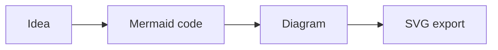

# dsh-mermaid

简体中文 | [English](README.md)

在 **DeepSeek Harness Web 和 Desktop** 会话中，把 Mermaid 代码块渲染为可交互的 SVG 图形。随时切换源码与图形，全屏查看大型图表，并直接导出 SVG 文件。

[](https://www.npmjs.com/package/dsh-mermaid)


英文 Pull Request 工作流在 DSH 会话中的实际效果。[查看 Mermaid 源码](docs/examples/pull-request-workflow.mmd)。

## 快速开始

需要 DeepSeek Harness（DSH）和 **Node.js 22.19 或更高版本**。以下命令使用 Windows PowerShell；macOS / Linux 用户请将 `npx.cmd`、`npm.cmd` 替换为 `npx`、`npm`。

### 1. 安装插件

已全局安装 `dsh` 时，将 npm 发布版安装到 Web profile：

```powershell
dsh plugin --profile web add -w dsh-mermaid
```

如果 PATH 中没有 `dsh` 命令，可通过 npx 调用：

```powershell
npx.cmd --yes @deepseek-ai/dsh plugin --profile web add -w dsh-mermaid
```

使用 **DSH Desktop** 时，将 `--profile web` 替换为 `--profile desktop`。DSH 会通过 pnpm 安装包，并根据包内的 `dsh.bundle` 声明自动注册到所选 profile。安装后重启 DSH Web 或 DSH Desktop；已经打开的 Web 页面也请刷新。

### 2. 生成图表

让模型输出 Mermaid 围栏代码块，例如：

````markdown

````

代码块默认显示为**图形**，点击**代码 / 图形**即可切换视图。插件也识别 `mermaidjs`、`mmd` 围栏标记，不处理行内代码。

### 3. 查看与导出

- **全屏**：打开独立查看器，支持鼠标滚轮缩放、拖拽、恢复 100% 和适应窗口；按 `Esc` 关闭。
- **下载 SVG**：将渲染后的图形保存为独立文件。
- 图形成功渲染后，切换到代码视图仍可使用全屏和下载操作。


## 功能特性

- **流式输出适配**：随回复发现新代码块，避免旧的异步渲染覆盖新内容。
- **主题与语言**：跟随 DSH 浅色 / 深色主题，根据页面和浏览器语言显示简体中文或英文。
- **大型图表查看**：全屏缩放与拖拽，切换视图时保持工具栏位置稳定。
- **无障碍支持**：管理键盘焦点，播报渲染与下载状态，为 SVG 提供可访问名称。
- **内置运行时**：固定打包 Mermaid `11.17.0`，从 DSH 同源按需加载，不依赖运行时 CDN；多图通过串行队列渲染。
- **源码回退**：使用 Mermaid `securityLevel: strict`，渲染失败时显示源码；单图超过 50,000 字符或 2,000 行时，在渲染前拒绝处理。

## 更新与卸载

按实际安装的 profile 执行；DSH Desktop 用户将 `web` 替换为 `desktop`。

```powershell
# 更新 npm 发布版
dsh plugin --profile web update -w dsh-mermaid

# 卸载
dsh plugin --profile web remove -w dsh-mermaid
```

如需通过 npx 调用，将开头的 `dsh` 替换为 `npx.cmd --yes @deepseek-ai/dsh`。操作完成后重启对应的 DSH 应用，并刷新已打开的 Web 页面。版本变化见[更新日志](CHANGELOG.md)。

## 常见问题

| 现象 | 排查方法 |
| --- | --- |
| 没有出现代码 / 图形按钮 | 确认插件安装在当前使用的 profile 中，重启 DSH 并刷新页面；使用明确标记为 `mermaid` 的围栏代码块。 |
| 显示源码和错误提示 | 根据提示检查 Mermaid 语法；超过 50,000 字符或 2,000 行时，拆分为多张图。 |
| 无法全屏或下载 | 这两个操作需要已成功渲染的 SVG，请先解决渲染错误。 |
| GitHub 安装提示构建脚本被阻止 | 参照下方“安装 GitHub 源码版”中的构建脚本说明。 |

## 兼容性

最近一次界面验证于 **2026-10-28** 完成：Windows / Chrome、`@deepseek-ai/dsh 0.2.1-rc.3`（Web profile）、`dsh-mermaid 0.4.4`，DSH 宿主使用 Desktop 随附的 Node.js 24.21.0。

本次使用独立环境中的本地示例会话，确认了英文流程图渲染、工具栏显示、全屏打开与关闭，以及全屏拖拽；上方截图来自该环境。这是界面冒烟验证，未覆盖全部功能回归或 Desktop 原生窗口。

DSH 仍处于开发预览阶段，新版可能调整插件加载器或 Markdown DOM。[反馈问题](https://github.com/MrmoLabs/dsh-mermaid/issues)时，请附上 DSH、插件和 Node.js 版本、Web / Desktop profile，以及最小 Mermaid 示例；分享前请移除会话中的私人内容。

## 进阶使用

<details>
<summary>安装 GitHub 源码版</summary>

日常使用建议选择 npm 发布版。如需安装仓库最新源码，请先确保全局 `dsh` 命令在 PATH 中，再运行：

```powershell
npx.cmd -y github:MrmoLabs/dsh-mermaid install
```

安装到 DSH Desktop：

```powershell
npx.cmd -y github:MrmoLabs/dsh-mermaid install --profile desktop
```

仓库安装器会调用 DSH，把 GitHub 源安装到所选 profile，并在安装阶段构建。如果 pnpm 阻止了构建脚本，请把提示中的精确包名加入该 profile 的 `pnpm-workspace.yaml` 的 `allowBuilds` 中，再重新执行命令。完成后重启对应的 DSH 应用。

安装器支持简体中文与英文，依次读取 `DSH_MERMAID_LANG`、`DSH_LANG`、`LC_ALL`、`LC_MESSAGES`、`LANG`、`LANGUAGE`，然后使用系统语言；跳过 `C`、`POSIX` 等中性区域值。可设置 `DSH_MERMAID_LANG=en` 或 `DSH_MERMAID_LANG=zh-CN` 覆盖。该设置只影响安装器自身文案，与浏览器界面、DSH 和 pnpm 的语言独立。

</details>

<details>
<summary>运行时与集成边界</summary>

Mermaid 运行时在 DSH Web 浏览器或 Desktop 渲染进程中执行，这些环境具有 `window` 和 `document`。Node.js 宿主通过 HTTP 提供打包文件。Node.js 版本要求适用于安装、构建和插件宿主；本项目目前未提供受支持的 Node.js 校验 API。

`lib/mermaid-runtime.js` 是内部浏览器 bundle，随包发布是为了供插件的同源运行时路由使用，并非公开的包导出。通过解析 `dsh-mermaid/package.json` 再拼接路径访问此文件，会依赖可能变化的内部打包结构。

尝试在服务端复用解析器时，需要处理以下条件：

- 部分图类型在 `parse()` 阶段就会通过 DOMPurify 清洗标签。缺少 DOM 时，合法的带标签 flowchart 和状态图也可能抛出 `addHook is not a function` 或 `sanitize is not a function`。某个时序图解析通过，不能证明其他输入也兼容。
- 在**首次导入运行时之前**提供兼容 DOM，建议放在独立 worker 或进程中。DOMPurify 会在初始化时捕获环境；导入后补 DOM 无法修复已缓存的模块。在异步导入期间临时修改全局变量，也可能被宿主的其他代码观察到。选择 DOM 实现时请参考 [DOMPurify 服务端说明](https://github.com/cure53/DOMPurify#running-dompurify-on-the-server)。
- Windows 上将绝对文件路径传入动态 `import()` 前，需要使用 `pathToFileURL(runtimePath).href` 转为文件 URL。
- 区分输入无效与依赖不可用、环境故障、超时等失败。Mermaid 错误的 `.hash` 字段不是通用分类依据：错误的 pie 语法、未知图类型也可能不带该字段。校验未完成时不能报告通过。
- 使用与渲染端一致的 Mermaid 版本及相关配置。`parse()` 通过仅表示语法检查通过，不能保证布局或 SVG 渲染成功；渲染端仍需保留错误处理和源码回退。

</details>

## 本地开发

在本地仓库中执行，需要 Node.js 22.19 或更高版本：

```powershell
npm.cmd install
npm.cmd run check
npm.cmd run build
dsh plugin --profile web add -w .
```

构建产物位于 `lib/`。轻量的 `client.js` 启动器由 DSH 客户端模块加载器注册为 `dsh-mermaid`；打包后的 Mermaid 运行时通过插件的同源宿主路由按需加载。DSH 会以当前插件项目为基准解析相对安装路径。

`npm.cmd run check` 执行语法检查与客户端测试，构建运行时，并在独立进程中分别验证有 DOM、无 DOM 时真实解析器的行为。提供 DOM 的解析测试使用 happy-dom 作为测试环境，不验证浏览器布局或 SVG 渲染效果，也不代表推荐将其用作生产服务端 DOM 实现。

<details>
<summary>本地开发时手动安装</summary>

也可以把构建后的包复制到：

```text
C:\Users\<用户名>\.dsh\profiles\web\node_modules\dsh-mermaid
```

不要把整个 `.dsh` 目录提交到 Git，其中可能包含会话和凭据。

</details>

### 发布检查

```powershell
npm.cmd run check
npm.cmd run build
npm.cmd pack --dry-run
git status --short
git diff --cached
```

## 许可证

[MIT](LICENSE)
